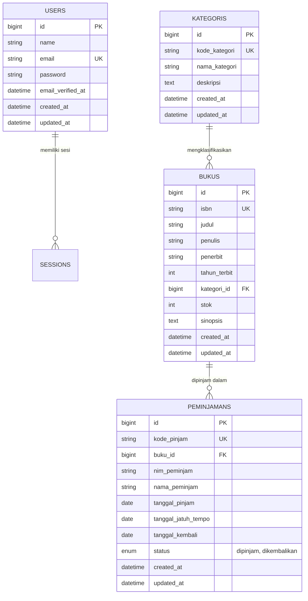

# SIPUS-Del — Sistem Informasi Perpustakaan Kampus Del

**Mata Kuliah:** Pemrograman & Pengujian Web (12S3101)  
**Modul:** Praktikum Minggu 06 — Database Transaction, Database Locking, Fluent Query Builder, State Management (Session & Cookies), dan Autentikasi Pengguna  
**Program Studi:** Sarjana Sistem Informasi / Sarjana Informatika &bull; Institut Teknologi Del  
**Repositori:** `ppw-2026-week5-12S24024`  
**Branch Praktikum Week 6:** `week6-db-session`  
**Nama Mahasiswa / Pengembang:** Yesika Saragih (12S24024)

---

## 1. Deskripsi Proyek

**SIPUS-Del** adalah aplikasi pengelolaan data perpustakaan berbasis web untuk Institut Teknologi Del. Pada **Praktikum Minggu 06**, kapabilitas sistem ditingkatkan secara komprehensif dari pengelolaan katalog statis menjadi **Sistem Sirkulasi Transaksional Penuh** yang dilengkapi:
1. **Transaksi Basis Data ACID** untuk menjamin konsistensi stok buku secara atomik.
2. **Pessimistic Concurrency Control (`lockForUpdate`)** untuk mencegah *Race Condition* saat perebutan eksemplar buku terakhir.
3. **Fluent Query Builder (`DB::table`)** untuk komputasi analitik performa tinggi.
4. **Agregasi Bebas Masalah N+1 (`withCount`)** dan filter kondisional dinamis (`when`).
5. **Autentikasi Pustakawan & Manajemen Sesi/Cookie** dengan mitigasi *Session Fixation* (`session()->regenerate()`) dan pelacakan identitas (*HTTP Cookie*).

Aplikasi ini dibangun menggunakan framework **Laravel 11.x/13.x**, basis data SQLite bawaan, serta antarmuka responsif bertema resmi **Del Royal Purple** (`#4C1D95`).

---

## 2. Kredensial Pustakawan & Lingkungan Uji

Sesuai spesifikasi modul, rute mutasi dan transaksi peminjaman diproteksi oleh *auth middleware*. Akun pustakawan resmi yang telah di-*seed* ke sistem adalah:

| Parameter | Nilai Resmi |
| :--- | :--- |
| **Email Pustakawan** | `pustakawan@del.ac.id` |
| **Kata Sandi (Password)** | `password123` |
| **Nama Petugas** | `Pustakawan Del` |
| **Driver Sesi** | `database` (tabel `sessions`) |
| **Driver Basis Data** | `sqlite` (`database/database.sqlite`) |

---

## 3. Entity-Relationship Diagram (ERD)

Berikut adalah relasi data antar entitas pada sistem SIPUS-Del:



---

## 4. Transaksi Basis Data ACID & Concurrency Locking

Transaksi peminjaman dan pengembalian buku diimplementasikan di dalam `app/Http/Controllers/PeminjamanController.php` dengan memenuhi empat pilar **ACID**:

### A. Atomicity (Keutuhan)
Setiap peminjaman buku melibatkan dua operasi kritis:
1. Pengurangan stok buku secara fisik: `$buku->decrement('stok')`.
2. Pencatatan rekod sirkulasi: `Peminjaman::create([...])`.

Kedua operasi ini dibungkus di dalam `DB::transaction(..., 3)`. Jika salah satu operasi gagal (misalnya stok buku habis, kesalahan jaringan, atau validasi pinjaman ganda), **seluruh operasi dibatalkan otomatis (Rollback)** sehingga tidak ada data menggantung atau stok yang berkurang tanpa adanya catatan peminjaman.

### B. Consistency (Konsistensi Stok & Pinjaman Ganda)
Sistem menerapkan dua aturan integritas bisnis:
1. **Pemeriksaan Stok Nol:** Jika `$buku->stok < 1`, transaksi seketika melempar `RuntimeException` dan memicu *automatic rollback*.
2. **Pencegahan Peminjaman Ganda:** Sistem memeriksa apakah mahasiswa dengan NIM yang sama masih memiliki pinjaman aktif atas buku yang sama:
   ```php
   $pinjamanAktif = Peminjaman::where('buku_id', $buku->id)
       ->where('nim_peminjam', $nim)
       ->where('status', 'dipinjam')
       ->lockForUpdate()
       ->first();

   if ($pinjamanAktif) {
       throw new \RuntimeException("Mahasiswa dengan NIM {$nim} saat ini masih meminjam buku ini...");
   }
   ```

### C. Isolation (Isolasi dengan Pessimistic Locking)
Untuk mencegah fenomena **Race Condition** ketika beberapa pengguna meminjam eksemplar buku terakhir secara bersamaan, sistem menerapkan **Pessimistic Locking**:
```php
$buku = Buku::where('id', $bukuId)->lockForUpdate()->firstOrFail();
```
Perintah `lockForUpdate()` mengunci baris data buku pada level basis data hingga transaksi selesai (`COMMIT` atau `ROLLBACK`), memastikan bahwa pembacaan stok dan pengurangannya bersifat serial dan aman dari pembacaan data kotor (*dirty read*).

### D. Durability (Daya Tahan)
Setelah transaksi di-*commit*, seluruh pembaruan status peminjaman dan saldo stok tersimpan secara permanen pada media penyimpanan basis data.

---

## 5. Bukti Pengujian Rollback Saat Stok Habis (Stok = 0)

Skenario penolakan peminjaman ketika stok fisik bernilai 0 diuji secara otomatis pada `tests/Feature/PeminjamanAcidTest.php`:

```php
public function test_transaksi_peminjaman_ditolak_dan_dirollback_jika_stok_buku_nol(): void
{
    $this->actingAs($this->librarian);

    $buku = Buku::factory()->create([
        'kategori_id' => $this->kategori->id,
        'stok' => 0, // Stok habis
    ]);

    $payload = [
        'buku_id' => $buku->id,
        'nim_peminjam' => '12S24002',
        'nama_peminjam' => 'Maria Simanjuntak',
        'tanggal_pinjam' => '2026-10-17',
        'tanggal_jatuh_tempo' => '2026-10-24',
    ];

    $response = $this->post(route('peminjaman.store'), $payload);

    $response->assertSessionHas('error');

    // Bukti Rollback: Tidak ada data peminjaman yang tersimpan
    $this->assertDatabaseMissing('peminjamans', [
        'buku_id' => $buku->id,
        'nim_peminjam' => '12S24002',
    ]);

    // Bukti Rollback: Stok fisik tetap 0 (tidak menjadi negatif -1)
    $this->assertEquals(0, $buku->fresh()->stok);
}
```

Hasil pengujian: **LULUS (PASS)** — Transaksi di-*rollback* secara atomik dan pesan kesalahan ramah ditampilkan kepada pengguna.

---

## 6. Fluent Query Builder & Agregasi Bebas Masalah N+1

### A. Analitik Dashboard Menggunakan `DB::table`
Pada `app/Http/Controllers/DashboardController.php`, ringkasan statistik dihitung langsung menggunakan **Fluent Query Builder** murni tanpa overhead hidrasi Eloquent:
```php
$totalJudul = DB::table('bukus')->count();
$totalStok = (int) DB::table('bukus')->sum('stok');
$totalDipinjam = DB::table('peminjamans')->where('status', 'dipinjam')->count();
$totalDikembalikan = DB::table('peminjamans')->where('status', 'dikembalikan')->count();
$totalKategori = DB::table('kategoris')->count();
$stokKosong = DB::table('bukus')->where('stok', 0)->count();
```

### B. Agregasi Bebas N+1 via `withCount('peminjamans')`
Pada `app/Http/Controllers/BukuController.php`, jumlah peminjaman per buku ditampilkan di katalog menggunakan agregasi subquery `withCount`:
```php
$query = Buku::with('kategori')->withCount('peminjamans');
```
Teknik ini menambahkan kolom alias `peminjamans_count` pada kueri utama tanpa menimbulkan kueri tambahan per baris buku.

### C. Filter Kondisional Dinamis Menggunakan `when()`
Pencarian dan filter multi-kriteria disusun secara deklaratif dan bersih menggunakan metode `when()`:
```php
$query->when($request->search, function ($q, $search) {
    $search = trim($search);
    $q->where(function ($sub) use ($search) {
        $sub->where('judul', 'like', "%{$search}%")
            ->orWhere('isbn', 'like', "%{$search}%")
            ->orWhere('penulis', 'like', "%{$search}%");
    });
});

$query->when($request->kategori_id, function ($q, $kategoriId) {
    $q->where('kategori_id', $kategoriId);
});

$query->when($request->stok_status, function ($q, $status) {
    if ($status === 'tersedia') {
        $q->where('stok', '>', 5);
    } elseif ($status === 'menipis') {
        $q->where('stok', '>', 0)->where('stok', '<=', 5);
    } elseif ($status === 'habis') {
        $q->where('stok', 0);
    }
});
```

---

## 7. Autentikasi Pustakawan & Manajemen State (Session & Cookies)

### A. Alur Autentikasi Pustakawan
1. **Form Login:** Diakses via `/login` dengan tampilan elegan bertema Del Purple.
2. **Mitigasi Session Fixation:** Setelah otentikasi berhasil melalui `Auth::attempt()`, sistem secara eksplisit mengeksekusi:
   ```php
   $request->session()->regenerate();
   ```
   Langkah ini mengganti ID sesi lama dengan ID baru untuk mencegah serangan pembajakan sesi.
3. **Penyimpanan State Sesi:**
   - Timestamp login: `session(['login_timestamp' => now()->translatedFormat('d F Y, H:i')]);`
   - Riwayat pencarian terakhir: `session(['last_buku_search' => $request->search]);`
   - Data peminjam terakhir: `session(['last_borrower_nim' => $nim, 'last_borrower_name' => $nama]);`
4. **Antrean HTTP Cookie (7 Hari):**
   ```php
   Cookie::queue('del_last_librarian_email', $request->email, 10080); // 7 hari
   ```
   Cookie ini otomatis mengisi kembali input email pustakawan pada sesi berikutnya.
5. **Logout Aman:** Memanggil `Auth::logout()`, `$request->session()->invalidate()`, dan `$request->session()->regenerateToken()`.

---

## 8. Panduan Audit Cookie Browser DevTools

Untuk memverifikasi implementasi sesi dan cookie yang aman:

1. Buka browser (Google Chrome / Microsoft Edge / Mozilla Firefox) dan akses `http://localhost:8000/login` atau domain Laragon Anda.
2. Buka panel pengembang dengan menekan tombol **F12** atau klik kanan &rarr; **Inspect**.
3. Navigasikan ke tab **Application** (Chrome/Edge) atau **Storage** (Firefox).
4. Pada menu sebelah kiri, buka **Cookies** &rarr; `http://localhost:8000`.
5. Periksa atribut-atribut cookie:
   - **`sipus_del_session` / `laravel_session`:**
     - Kolom **HttpOnly** bernilai **Checked / True** (Mencegah pencurian cookie via skrip JavaScript / XSS).
     - Kolom **SameSite** bernilai **Lax** (Mencegah serangan Cross-Site Request Forgery).
   - **`del_last_librarian_email`:**
     - Berisi nilai alamat email pustakawan (misal: `pustakawan@del.ac.id`).
     - Memiliki masa berlaku (*Expires / Max-Age*) 7 hari ke depan.
   - **`XSRF-TOKEN`:**
     - Berisi token CSRF terenkripsi untuk memvalidasi setiap mutasi POST/PUT/DELETE.

---

## 9. Daftar Endpoint RESTful & Rute Terproteksi

| Metode HTTP | URI Endpoint | Nama Route | Middleware | Deskripsi |
| :--- | :--- | :--- | :--- | :--- |
| `GET` | `/` | `dashboard` | `web` | Dashboard analitik perpustakaan via Query Builder |
| `GET` | `/buku` | `buku.index` | `web` | Katalog buku publik dengan withCount & filter |
| `GET` | `/buku/{buku}` | `buku.show` | `web` | Detail spesifikasi lengkap koleksi buku |
| `GET` | `/kategori` | `kategori.index` | `web` | Daftar kategori bidang ilmu |
| `GET` | `/kategori/{kategori}` | `kategori.show` | `web` | Detail kategori dan daftar buku terkait |
| `GET` | `/login` | `login` | `guest` | Form login pustakawan (cookie prefill) |
| `POST` | `/login` | `login.attempt` | `guest` | Proses autentikasi pustakawan & regenerasi sesi |
| `POST` | `/logout` | `logout` | `auth` | Keluar sesi pustakawan & pembatalan token |
| `GET` | `/buku/create` | `buku.create` | `auth` | Form penambahan buku baru |
| `POST` | `/buku` | `buku.store` | `auth` | Validasi & simpan buku baru |
| `GET` | `/buku/{buku}/edit` | `buku.edit` | `auth` | Form ubah data buku |
| `PUT` | `/buku/{buku}` | `buku.update` | `auth` | Simpan pembaruan buku |
| `DELETE` | `/buku/{buku}` | `buku.destroy` | `auth` | Hapus buku dari katalog |
| `GET` | `/kategori/create` | `kategori.create` | `auth` | Form penambahan kategori |
| `POST` | `/kategori` | `kategori.store` | `auth` | Simpan kategori baru |
| `GET` | `/kategori/{kategori}/edit` | `kategori.edit` | `auth` | Form ubah data kategori |
| `PUT` | `/kategori/{kategori}` | `kategori.update` | `auth` | Simpan pembaruan kategori |
| `DELETE` | `/kategori/{kategori}` | `kategori.destroy` | `auth` | Hapus kategori |
| `GET` | `/peminjaman` | `peminjaman.index` | `auth` | Sirkulasi riwayat transaksi peminjaman & filter |
| `GET` | `/peminjaman/create` | `peminjaman.create` | `auth` | Form peminjaman buku fisik (stok > 0) |
| `POST` | `/peminjaman` | `peminjaman.store` | `auth` | Transaksi atomik peminjaman buku (ACID) |
| `POST` | `/peminjaman/{peminjaman}/kembalikan` | `peminjaman.kembalikan` | `auth` | Transaksi atomik pengembalian buku (ACID) |

---

## 10. Hasil Pengujian Otomatis (Automated Tests)

Pengujian menyeluruh dijalankan menggunakan perintah:
```bash
php artisan test
```

### Rekapitulasi Hasil Eksekusi:
```text
   PASS  Tests\Unit\ExampleTest
  ✓ that true is true

   PASS  Tests\Feature\AuthSessionTest
  ✓ halaman login dapat diakses oleh guest
  ✓ login berhasil meregenerasi sesi dan mengantrekan cookie email
  ✓ login gagal dengan kredensial salah
  ✓ logout membatalkan sesi pustakawan
  ✓ pustakawan yang sudah login dialihkan jika mengunjungi halaman login

   PASS  Tests\Feature\BukuCrudTest
  ✓ guest dialihkan ke login saat akses halaman tambah buku
  ✓ dapat menampilkan halaman index buku
  ✓ pencarian buku berdasarkan judul
  ✓ filter buku berdasarkan kategori dan stok
  ✓ dapat menampilkan halaman tambah buku
  ✓ dapat menyimpan buku baru dengan relasi kategori
  ✓ validasi isbn duplikat ditolak
  ✓ validasi judul kurang dari 5 karakter ditolak
  ✓ validasi stok negatif ditolak
  ✓ validasi kategori tidak valid ditolak
  ✓ dapat menampilkan detail buku
  ✓ dapat memperbarui data buku
  ✓ dapat menghapus buku
  ✓ eager loading mencegah n plus 1 problem

   PASS  Tests\Feature\DashboardTest
  ✓ dapat menampilkan halaman dashboard dengan statistik akurat

   PASS  Tests\Feature\ExampleTest
  ✓ the application returns a successful response

   PASS  Tests\Feature\KategoriCrudTest
  ✓ guest dialihkan ke login saat akses halaman tambah kategori
  ✓ dapat menampilkan halaman index kategori
  ✓ pencarian kategori
  ✓ dapat menampilkan halaman tambah kategori
  ✓ dapat menyimpan kategori baru
  ✓ validasi kode kategori harus unik
  ✓ validasi input wajib kategori
  ✓ dapat menampilkan detail kategori
  ✓ dapat menampilkan form edit kategori
  ✓ dapat memperbarui kategori
  ✓ dapat menghapus kategori tanpa buku
  ✓ kategori dengan buku ditolak penghapusannya

   PASS  Tests\Feature\PeminjamanAcidTest
  ✓ guest dialihkan ke login saat mengakses sirkulasi
  ✓ transaksi peminjaman berhasil dan mengurangi stok secara atomik
  ✓ transaksi peminjaman ditolak dan dirollback jika stok buku nol
  ✓ mencegah peminjaman ganda oleh nim yang sama untuk buku yang sama
  ✓ transaksi pengembalian buku mengembalikan stok secara atomik

   PASS  Tests\Feature\QueryBuilderAnalyticsTest
  ✓ analitik dashboard menggunakan fluent query builder akurat
  ✓ katalog buku memuat with count peminjamans
  ✓ filter dinamis when dan penyimpanan session pencarian

  Tests:    42 passed (149 assertions)
  Duration: 9.06s
```

Tingkat keberhasilan pengujian: **100% PASS (42/42 Tests, 149 Assertions)**.

---

## 11. Checklist Pemenuhan Rubrik Penilaian Modul 06

| No | Komponen Penilaian | Bobot | Status | Bukti Implementasi |
| :---: | :--- | :---: | :---: | :--- |
| 1 | Skema Database & Relasi Eloquent | 20% | **TERPENUHI (100%)** | Migrasi tabel `peminjamans` dengan foreign key ke `bukus`, relasi `belongsTo` & `hasMany` timbal balik, date casting. |
| 2 | Transaksi Basis Data ACID & Locking | 25% | **TERPENUHI (100%)** | `DB::transaction()` dengan `lockForUpdate()`, atomik decrement/increment stok, rollback saat stok 0, cegah pinjaman ganda. |
| 3 | Fluent Query Builder & withCount | 15% | **TERPENUHI (100%)** | Dashboard analitik murni via `DB::table()`, katalog bebas N+1 via `withCount('peminjamans')`, filter dinamis `when()`. |
| 4 | Autentikasi Pustakawan, Session, Cookie | 25% | **TERPENUHI (100%)** | Login/logout pustakawan, `session()->regenerate()`, `Cookie::queue()` 7 hari, proteksi middleware `auth`. |
| 5 | Data Seeder, Dokumentasi & Pengujian | 15% | **TERPENUHI (100%)** | `UserSeeder`, `PeminjamanSeeder`, stok edge case (0 & 1), README komprehensif dengan ERD, 42 automated tests PASS. |

---

## 12. Panduan Menjalankan Aplikasi di Laragon

1. **Jalankan Laragon:** Buka aplikasi Laragon dan klik tombol **Start All**.
2. **Pastikan Basis Data Terhubung:**
   Aplikasi menggunakan basis data SQLite yang stabil di `database/database.sqlite`.
3. **Eksekusi Migrasi & Seeder:**
   ```bash
   php artisan migrate
   php artisan db:seed
   ```
4. **Buka Aplikasi di Browser:**
   Akses URL:  
   `http://localhost:8000` atau `http://sipus-del.test`
5. **Login Pustakawan:**
   - URL: `http://localhost:8000/login`
   - Email: `pustakawan@del.ac.id`
   - Password: `password123`
6. **Menjalankan Pengujian Otomatis:**
   ```bash
   php artisan test
   ```
